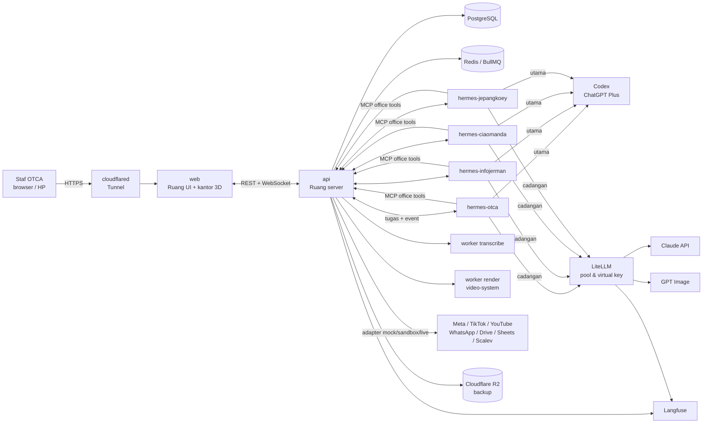
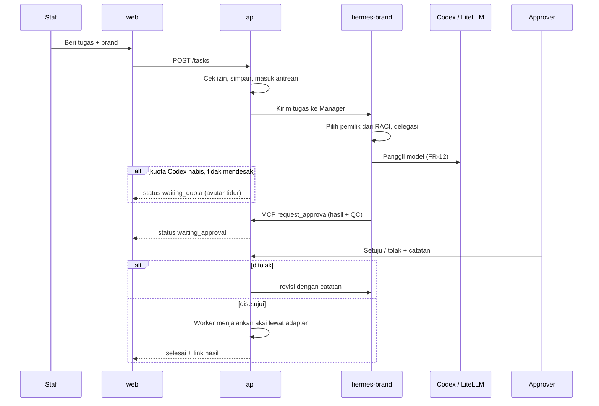
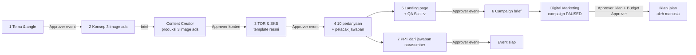

# Rancangan Pengembangan AI Office 3D OTCA

Rencana kerja dari requirement sampai pilot, disusun dari **Blueprint AI Office 3D OTCA v3.1** dan paket
**`context/`** (lihat `context/README.md`). Dokumen ini menjadi acuan Builder dan Brain; ubah lewat pull request.

- Versi: 1.1 · 2 November 2026
- Status: **DISETUJUI ARAH**. Semua pertanyaan terbuka v1.0 sudah dijawab (lihat [bagian 10](#10-keputusan-dan-pertanyaan)).
- Penanda: **[BP]** = mengikuti blueprint · **[UBAH]** = berbeda dari blueprint, alasannya ditulis · **[KONFIRMASI]** = belum diputuskan

**Prinsip dokumen:** semuanya mengikuti blueprint, kecuali dua hal yang ditetapkan Pengguna:
1. **Kantor 3D memakai repo ini (Ruang)**, bukan fork Hermes Virtual Office.
2. **Event Specialist OTCA menjadi prioritas pertama**, bukan Social Media Manager. Urutan roadmap disusun ulang di sekitarnya.

---

## 1. Tujuan dan ruang lingkup

AI Office adalah kantor virtual tempat **4 brand OTCA** menjalankan **AI agent marketing & creative**. Staf
memberi tugas lewat web, agent mengerjakan, manusia menyetujui, dan semua aksi ke luar (posting, iklan, pesan,
landing page) berjalan lewat API resmi setelah approval. Kantor 3D menampilkan siapa sedang mengerjakan apa.

| Brand | Slug | Agent aktif | Platform | Lantai 3D |
|---|---|---|---|---|
| Official OTCA | `otca` | Manager + Content Creator, Video Editor, Social Media Manager, Digital Marketing, Event Specialist | IG, FB, TikTok, YouTube Shorts | Lantai 1 · 6 meja |
| Info Jerman | `infojerman` | Manager + Content Creator, Video Editor, Social Media Manager | IG, FB, TikTok | Lantai 2 · 4 meja |
| Ciao Manda | `ciaomanda` | Manager + Content Creator, Video Editor, Social Media Manager | TikTok, IG Reels | Lantai 3 · 4 meja |
| Jepang Koey | `jepangkoey` | Manager + Content Creator, Video Editor, Social Media Manager | TikTok, IG Reels | Lantai 4 · 4 meja |

Total **18 agent**: 4 Manager + 14 spesialis. Sister brand yang butuh iklan atau event mengirim brief ke Digital
Marketing / Event Specialist OTCA.

**Di luar lingkup v1:**
- budget iklan Meta/Google, Canva Pro, dan biaya Scalev;
- broadcast WhatsApp otomatis;
- aktivasi iklan oleh agent (tidak akan pernah diberikan);
- akses dari claude.ai lewat MCP dan mode cermin (dihapus, lihat 5.3).

---

## 2. Keputusan yang sudah diambil

| Topik | Keputusan | Sumber |
|---|---|---|
| Fondasi | 1 container **Hermes Agent per brand**, LiteLLM, PostgreSQL, Redis, worker video | [BP] |
| Mesin AI | **Codex (ChatGPT Plus) utama**, Claude lewat LiteLLM sebagai cadangan dengan pool budget | [BP] |
| Mesin per tahap | **Development:** Codex (ChatGPT Plus) untuk semua brand, satu langganan. **Production:** tambah Claude API lewat LiteLLM untuk pool umum dan pool video (Opus 5.5 untuk Video Editor), tetap dengan Codex sebagai mesin utama. Pilihan mesin diatur lewat konfigurasi per lingkungan, bukan cabang kode terpisah. | ditetapkan Pengguna, 3 Nov 2026 |
| Model bisa diatur | Model tiap agent dan bobot tugas (sederhana, kompleks, mendesak) bisa diubah dari halaman Agents tanpa deploy: override disimpan di `agent_routes`, divalidasi per profil (dev hanya Codex, prod juga pool Claude), diuji dengan tombol Uji, dan dicatat di audit log. Default tetap tabel FR-12. | ditetapkan Pengguna, 4 Nov 2026 |
| Berkas hasil agent | Agent tidak punya alat file; berkas ditulis sebagai blok `~~~file:nama.ext` di balasan chat, disaring server (nama polos, ekstensi teks atau pdf, maks 200 KB, maks 5), dan disimpan sebagai aset. Berkas biner (PDF sekarang; gambar dan video nanti) disimpan di file store dengan kunci berawalan `brand_id`. PDF dibuat dari Markdown lewat templat cetak berbrand (logo, font Montserrat atau Lato dari `visual.json`, tabel dengan header berulang, header dan footer bernomor halaman) yang dicetak Chromium tanpa jaringan dan tanpa skrip, satu render sekaligus, dengan cadangan `pdfkit` (huruf Latin saja) bila browser tidak ada. Di server, Chromium harus terpasang (`RENDER_CHROME_PATH`) beserta font CJK bila perlu; worker render terpisah, gambar lewat pool gambar, dan video lewat `video-system` mengikuti roadmap. Upload skill, connector, dan plugin menunggu SSO dan RBAC (L4). | ditetapkan Pengguna, 4 Nov 2026 |
| Pool gambar | GPT Image lewat **OpenAI API key** dengan pool $10, bukan ChatGPT Plus (langganan Plus tidak mencakup pemakaian API). Adapter tetap `mock` sampai key tersedia. | [BP] baris pool gambar, dikoreksi 3 Nov 2026 |
| Login Codex | Setiap container Hermes punya login sendiri. Keempat brand sudah login (`hermes auth add openai-codex`, device code) pada satu akun ChatGPT Plus. Uji 4 Nov 2026: refresh token dipaksa (`hermes auth refresh`) di Info Jerman lalu di OTCA; keempat container tetap berhasil menjalankan tugas, jadi refresh satu container tidak membatalkan yang lain. Belum teruji: token yang kedaluwarsa alami, kuota bersama, dan syarat layanan OpenAI untuk satu akun antar brand. | uji 3-4 Nov 2026 |
| Web & kantor 3D | **Ruang (repo ini) menjadi `web` + `api`**, termasuk kantor 3D-nya | [UBAH], ditetapkan Pengguna |
| Prioritas agent | **Event Specialist OTCA pertama** (MVP), lalu agent yang dibutuhkan workflow event: Content Creator, lalu Digital Marketing | [UBAH], ditetapkan Pengguna |
| Orkestrasi | **Manager per brand**, CEO global dihapus | [BP] |
| Model | Pohon keputusan Bab 08 dan rasio Sonnet Bab 10: Content Creator ≤20%, Event Specialist ≤30%, Digital Marketing ≤50%. Sistem tier `ringan/normal/berat` di kode sekarang dibuang. | [BP] |
| Pool | Umum $20, video $20, gambar $10; key per brand $5 per pool untuk umum & video; pool gambar OTCA $4, sister brand masing-masing $2 | [BP] + jawaban #3 |
| Lokasi | **Lokal dulu** (laptop Windows + Docker Desktop), pindah ke **Contabo Cloud VPS 8** sebelum pilot | [UBAH], ditetapkan Pengguna |
| Tim | Builder = pemilik repo, penuh (±8 jam/hari), mulai 3 Nov 2026. Brain belum ditunjuk. | ditetapkan Pengguna |
| Integrasi tanpa akun | GPT Image, Meta Ads sandbox, YouTube, WhatsApp Business, dan Scalev dibuat **kerangkanya dulu** (adapter + mode `mock`) dan dinyalakan saat akun tersedia | jawaban #8 |
| Pipeline video | Worker `render` memakai **`VIDEO_EDITOR/video-system`** (Python + Remotion), disesuaikan dengan blueprint dan best practice | jawaban #10 |
| Konteks | `context/` di repo adalah sumber tunggal aturan, agent, dan brand; di-mount read-only ke Hermes | [BP] |
| Aturan & memori tambahan | Tabel `agent_notes` per brand (untuk satu agent atau semua agent brand), bisa ditambah, diubah, dinonaktifkan, dihapus dari tab Memori & Rules dan halaman Memory; dimuat ke prompt setelah konteks resmi, yang selalu menang; batas 2.000 karakter per catatan, 100 per brand, 6.000 karakter di prompt; setiap perubahan masuk audit log (`note.*`). `context/` tetap hanya lewat PR. | FR-02, audit |
| Approval | Matriks per jenis pekerjaan + Budget Approver + consent record | [BP], `context/_shared/approval-matrix.md` |

---

## 3. Requirement fungsional

Nomor `FR-xx` dipakai di roadmap dan PR.

### 3.1 Agent dan routing
- **FR-01** Setiap brand punya satu container Hermes. Daftar agent aktif dibaca dari `context/brands/<slug>/agents.json`.
- **FR-02** Prompt agent = `context/agents/<id>.md` + `context/_shared/*` + `context/brands/<slug>/*`. Agent tidak boleh mengarang isi bagian `[KONFIRMASI]`.
- **FR-03** Manager menerima permintaan staf, mencari pemilik utama di `raci.md`, mendelegasikan, merangkum, lalu mengirim ke Approval yang tepat. Manager tidak mengerjakan pekerjaan spesialis.
- **FR-04** Manager sister brand meneruskan kebutuhan iklan/event sebagai brief ke agent OTCA (`brief_to_otca`).
- **FR-05** Antar-agent hanya bertukar brief terstruktur (`content_brief`, `campaign_brief`, `event_brief`, `asset_handoff`, `approval_request`; lihat `docs/otca-agents.md`).
- **FR-06** RACI: "Analisis feedback sales" dibedakan menurut tujuan, sama seperti Parents Talk. Insight konten milik Content Creator, insight marketing milik Digital Marketing (jawaban #2).

### 3.2 Tugas, antrean, dan model
- **FR-10** Staf membuat tugas dari web/kantor 3D: brand, agent (opsional, default Manager), judul, brief, prioritas, label mendesak.
- **FR-11** Tugas masuk antrean BullMQ per brand. Status tugas: `queued → running → waiting_approval → (revision → running) → approved → published/done`, ditambah `waiting_quota`, `failed`, `paused`, `cancelled`.
- **FR-12** Pemilihan model mengikuti pohon keputusan blueprint Bab 08:

  | Agent | Tugas kompleks | Tugas sederhana | Cadangan (pool umum, hanya mendesak) |
  |---|---|---|---|
  | Manager | Codex tinggi | Codex rendah | Haiku 5.5 |
  | Event Specialist | Codex tinggi: tema & struktur PPT | Haiku: isi template, follow-up | Sonnet 5.5 ≤30% |
  | Content Creator | Codex tinggi: riset & angle | Codex rendah / Haiku: draft | Sonnet 5.5 final ≤20% |
  | Digital Marketing | Codex tinggi: strategi & analisis | Haiku: variasi copy, laporan rutin | Sonnet 5.5 ≤50% |
  | Social Media Manager | Codex: kalender & laporan | Codex rendah / Haiku: balasan, klasifikasi | Haiku 5.5 |
  | Video Editor | Opus 5.5: rencana edit (pool video) | Lokal + Haiku: transkrip & ringkasan | Pool video $20 |

  Kuota Codex habis dan tugas tidak mendesak → `waiting_quota`, lanjut otomatis setelah reset. Label mendesak hanya boleh diberikan Brand Manager/Approver.
- **FR-13** Batas per tugas: maks 15 langkah, 2 retry, budget per tugas; loop berhenti otomatis.
- **FR-14** Setiap langkah tercatat: model, token, biaya, durasi (Langfuse + tabel `cost_events`); rasio Sonnet per agent dipantau.

### 3.3 Approval dan peran
- **FR-20** Kotak Approval menampilkan brand, agent, jenis pekerjaan, approver yang berhak, sumber/izin, hasil QC, dan biaya AI.
- **FR-21** Routing approval mengikuti `approval-matrix.md`: konten, publikasi, iklan, budget, event, consent.
- **FR-22** Penolakan wajib disertai catatan; catatan dikirim balik ke agent sebagai revisi.
- **FR-23** Peran: Super Admin, Brand Manager, Approver konten, Approver iklan, Approver event, Budget Approver, Operator, Viewer. Cakupan: organisasi, brand, atau agent (blueprint Bab 17).
- **FR-24** Super Admin **tidak** bisa mengaktifkan iklan; hanya Budget Approver.
- **FR-25** Login SSO Google Workspace kantor; staf yang keluar dari Workspace otomatis kehilangan akses.
- **FR-26** Kill switch per agent dan per brand: semua tugas berjalan → `paused` dengan 1 klik.

### 3.4 Isolasi brand
- **FR-30** Container hanya me-mount `context/brands/<slug>` miliknya.
- **FR-31** Semua query DB, event WebSocket, dan file memakai filter `brand_id`; diuji otomatis setiap rilis.
- **FR-32** Virtual key LiteLLM per brand: $5 pool umum, $5 pool video, pool gambar OTCA $4 dan sister brand $2.

### 3.5 Integrasi (semua lewat `api`, bukan langsung dari Hermes)
- **FR-40** Setiap integrasi adalah adapter dengan tiga mode: `mock` (data palsu, untuk pengembangan dan tes), `sandbox` (akun uji), dan `live`. Mode diatur per brand. Adapter tanpa kredensial otomatis `mock` dan ditandai jelas di UI.
- **FR-41** Google Drive & Sheets: baca library & template, tulis laporan. *(akun tersedia)*
- **FR-42** Meta Graph API: posting IG/FB dan balas komentar **setelah approval**; baca komentar. *(tersedia)*
- **FR-43** Meta Marketing API: buat campaign/ad set/ad berstatus **PAUSED**, baca insight. Endpoint aktivasi & budget tidak ada di adapter. *(kerangka; akun sandbox belum ada)*
- **FR-44** TikTok *(tersedia)* / YouTube *(kerangka)*: posting setelah approval, sesuai izin API.
- **FR-45** WhatsApp Business: handover lead ke sales, bukan broadcast. *(kerangka)*
- **FR-46** Scalev: LP event & payment sesuai API yang tersedia; tanpa API, agent menyiapkan konten + checklist dan manusia memasang. *(kerangka)*
- **FR-47** CRM, Parents Talk, chat export: dibaca setelah dianonimkan.
- **FR-48** GPT Image (pool gambar) + template Canva per brand untuk draft visual. *(kerangka; OpenAI API key belum ada)*

### 3.6 Produksi per agent (urutan = prioritas)
- **FR-50 Event Specialist (OTCA), prioritas 1:**
  1. Riset tema dari Parents Talk (anonim).
  2. 3 konsep image ads dengan angle berbeda; brief produksi ke Content Creator.
  3. TOR/SKB dari template resmi tanpa mengubah struktur.
  4. 10 pertanyaan narasumber + pelacak jawaban & follow-up.
  5. LP event dari template OTCA + QA integrasi Scalev & payment.
  6. Campaign brief ke Digital Marketing.
  7. PPT dari jawaban narasumber sesuai brand OTCA.

  Setiap tahap melalui Approver event.
- **FR-51 Content Creator:** riset Parents Talk/feedback sales (anonim) → angle → draft → final Sonnet ≤20% → QC `checklist-publikasi.md` otomatis → Approval. Produksi 3 image ads event termasuk di sini.
- **FR-52 Digital Marketing (OTCA):** campaign plan, ads copy, struktur Meta Ads PAUSED (termasuk iklan event), audit LP/CRO, laporan mingguan ke Sheets, brief dari sister brand.
- **FR-53 Social Media Manager:** library Drive, kalender, scheduling, publish setelah approval, klasifikasi komentar, auto reply dari KB (di luar template → Approval), lead routing.
- **FR-54 Video Editor:** upload footage + form sumber & izin → transkrip lokal → ringkas segmen Haiku → rencana edit Opus → render lewat pipeline `video-system` dengan token dari `visual.json` → storyboard/preview → Approval → render penuh + QA (detail di 5.7).
- **FR-55** Footage tanpa data sumber dan testimoni tanpa consent record **tidak bisa** masuk Approval.

### 3.7 Kantor 3D (Ruang) dan dashboard
- **FR-60** Gedung 4 lantai, satu lantai per brand dengan warna resmi dari `visual.json`: OTCA 6 meja, sister brand masing-masing 4 meja.
  - Lantai 2 Ruang sekarang (kamar tidur dan lesehan) diganti lantai brand.
  - Lounge, game room, dan ruang rapat tetap ada di lantai 1 sebagai area bersama.
- **FR-61** 7 status avatar yang berbeda secara visual:
  - `idle`;
  - `working`;
  - `waiting_quota` (tidur di meja);
  - `waiting_approval`;
  - `revision`;
  - `error`;
  - `paused`.
- **FR-62** Klik meja agent → panel tugas & Approval; approve/reject bisa dari kantor 3D.
- **FR-63** Status real-time lewat WebSocket; lancar di laptop dan HP menengah.
- **FR-64** Dashboard 2D: daftar tugas, kotak Approval, biaya per brand per pool, sisa kuota Codex, audit log, status mode integrasi (mock/sandbox/live).

---

## 4. Requirement non-fungsional

| Area | Requirement |
|---|---|
| Keamanan | Seluruh SEC-01 s.d. SEC-12 blueprint Bab 18 lulus sebelum pilot |
| Biaya | Total ±$86/bulan (±Rp1,55 jt); pool API dikunci di LiteLLM; alert 50/80/100% |
| Kualitas | 70% hasil disetujui tanpa revisi pada tugas uji setiap agent |
| Kinerja | Render video satu per satu dan tidak mengganggu agent; RAM VPS < 85% rata-rata mingguan |
| Ketersediaan | Alert Telegram (Uptime Kuma); server baru bisa dipulihkan < 2 jam dari backup R2 |
| Privasi | Data pribadi dianonimkan sebelum ke model; tidak tampil di konten tanpa izin tertulis |
| Ketertelusuran | Setiap approve, posting, dan perubahan context tercatat di audit log |
| Bahasa | UI dan output agent dalam Bahasa Indonesia |

---

## 5. Arsitektur

### 5.1 Gambaran komponen



Prinsip utama:
1. **Hermes hanya berpikir dan menyusun draft.** Semua aksi ke luar dijalankan `api` setelah approval. Token Meta/TikTok/Google hanya ada di `api` (terenkripsi), tidak pernah di Hermes atau browser (SEC-03, SEC-04, SEC-05).
2. **Agent memakai tool lewat MCP yang disediakan `api`**, dengan kunci per brand. Server MCP yang ada di `server/mcp-tools.ts` diubah fungsinya: bukan lagi pintu untuk claude.ai, tetapi tool kantor untuk Hermes (`request_approval`, `read_template`, `draft_post`, `create_paused_campaign`, dan seterusnya). Setiap panggilan dikunci ke `brand_id` container pemanggil.
3. **Satu sumber status.** Status tugas di Postgres menggerakkan antrean, dashboard, dan animasi avatar sekaligus.

### 5.2 Komponen

| Service | Isi | Batas memori VPS | Asal |
|---|---|---|---|
| `cloudflared` | Tunnel ke Cloudflare; tidak ada port terbuka | — | baru |
| `web` | UI Ruang (React + R3F): kantor 3D, dashboard, Approval, login | 1 GB | Ruang `src/` |
| `api` | Express: REST, WebSocket, RBAC, antrean BullMQ, server MCP, adapter integrasi, scheduler | 1 GB | Ruang `server/` (di-refactor) |
| `hermes-<slug>` ×4 | Hermes Agent, profil per agent, mount `context/` read-only, `/data` per brand | 1,5 GB masing-masing | baru |
| `litellm` | Alias `cepat`/`final`/`video`/`gambar`, pool, virtual key per brand | 1 GB | baru |
| `postgres` | Data utama | 2 GB | baru (ganti file JSON) |
| `redis` | Antrean BullMQ, pub/sub event | 512 MB | baru |
| `transcribe` | WhisperX/faster-whisper dari `video-system` (ID/EN/DE/ZH/JP) | 3 GB, 2 CPU | `video-system` |
| `render` | Pipeline `video-system`: ingest, komposit Python, overlay Remotion, ekspor, QA | 4 GB, 4 CPU | `video-system` |
| Langfuse Cloud, R2, Uptime Kuma, Telegram | Observasi, backup, alert | — | layanan luar |

### 5.3 Dari kode Ruang sekarang ke target

| Bagian sekarang | Nasib |
|---|---|
| `server/claude-service.ts` (agent memanggil Claude API langsung, data di file JSON) | Runtime agent dipindah ke Hermes di L1; pemanggilan Claude langsung dihapus. Tugas dan riwayat penting dimigrasi ke Postgres. |
| Sistem tier `ringan/normal/berat` (belum di-commit) | **Dibuang** di L0 (jawaban #7); model mengikuti FR-12. |
| CEO + 5 agent OTCA | CEO dihapus; diganti Manager per brand. Manager OTCA ada sejak L1, sister brand di L4. |
| Agent Project claude.ai, tool `register_project_agent`, `report_activity` (mode cermin), `chat_with_agent` | **Dihapus** (jawaban #6). |
| `server/mcp.ts`, `server/mcp-http.ts`, `server/mcp-tools.ts` | Infrastruktur MCP dipakai ulang sebagai tool kantor untuk Hermes (5.1 butir 2). |
| `server/otca-context.ts` | Tetap dipakai `api` untuk QC, panel agent, dan tes isi context; Hermes membaca file yang sama lewat mount. |
| `server/mission-control.ts` (baca Hermes lewat CLI) | Diganti event dari `api`; pembacaan CLI hanya untuk diagnostik. |
| Kantor 3D (`src/pages/Office3D.tsx`, `src/office3d-layout.ts`) | Dipertahankan; menjadi 4 lantai brand, 7 status, panel Approval (L5). |
| Kanban (`todo/running/review/done`) | Diganti status FR-11; tampilan kolom tetap. |
| Profile lock / access code | Diganti login Google SSO + RBAC (L4). |

### 5.4 Model data (PostgreSQL)

| Tabel | Isi penting |
|---|---|
| `brands` | slug, nama, warna lantai, status aktif, kill switch |
| `agents` | brand_id, agent_type, nama, status avatar, kill switch |
| `users` | email Google, nama, aktif |
| `role_assignments` | user_id, role, cakupan (org / brand_id / agent_id) |
| `tasks` | brand_id, agent_id, pembuat, judul, brief, jenis pekerjaan, prioritas, mendesak, status, parent_task_id (delegasi Manager), langkah, retry |
| `task_events` | task_id, jenis event, payload, waktu (sumber animasi & timeline) |
| `approvals` | task_id, jenis approval, approver_role, approver_user_id, keputusan, catatan, waktu |
| `assets` | task_id, jenis (caption, carousel, gambar, video, dokumen, PPT, LP), versi, lokasi file/Drive, hasil QC |
| `events` | brand_id, tema, tanggal, harga, narasumber, status tahap (tema → ads → TOR/SKB → narasumber → LP → campaign → PPT) |
| `speaker_questions` | event_id, narasumber, pertanyaan, jawaban, status follow-up |
| `sources` | asset_id, URL, kreator, tanggal ambil, status izin (diizinkan / belum ditanyakan / ditolak) |
| `consents` | pemilik cerita, kanal, boleh untuk Ads, bukti, berlaku sampai |
| `cost_events` | task_id, brand_id, pool, model, token masuk/keluar, biaya, sumber (Codex/API) |
| `integrations` | brand_id, layanan, mode (mock/sandbox/live), token terenkripsi, kedaluwarsa (hanya dibaca `api`) |
| `schedules` | brand_id, agent_id, cron, brief |
| `audit_log` | aktor, aksi, objek, brand_id, waktu, data sebelum/sesudah |

Semua tabel yang punya `brand_id` diakses lewat satu lapisan repository yang **wajib** menerima `brand_id`; tes akses silang (FR-31) menguji lapisan ini.

### 5.5 Alur satu tugas



### 5.6 Workflow event (prioritas 1)



Satu event adalah satu baris `events` dengan tugas anak per tahap. Event Specialist memiliki workflow-nya; desain
oleh Content Creator dan iklan oleh Digital Marketing (`raci.md`, blueprint Bab 12).

### 5.7 Pipeline video (`VIDEO_EDITOR/video-system`)

Pipeline yang sudah ada sudah cocok dengan blueprint. Isinya:
- Python untuk ingest, transkrip WhisperX, wajah, rotoscope, komposit, ekspor, dan QA, ditambah Remotion untuk overlay;
- token per gaya dan beat-sheet;
- gerbang persetujuan storyboard (`setuju`);
- QA otomatis;
- proyek Info Jerman dan Ciao Manda yang sudah lulus QA.

| Langkah blueprint | Di `video-system` | Yang perlu dibuat |
|---|---|---|
| Upload + sumber & izin | `proyek/<nama>/manifest.json` | Form di web; `sources`/`consents` wajib sebelum `ingest` |
| Transkrip lokal | `video.py transkrip` (WhisperX) | Worker `transcribe` di container Linux |
| Keyframe + ringkas Haiku | — | Skrip keyframe FFmpeg + ringkasan Haiku per segmen |
| Rencana edit Opus → JSON | `beat-sheet.json` + `video.py pasang` | Opus mengisi beat-sheet; divalidasi skema sebelum dipakai |
| Render dari `visual.json` | `manifest.token_override` | Pemetaan `visual.json` → token per brand (font, warna, safe zone, logo, kredit sumber) |
| Preview + Approval | `video.py storyboard` lalu `setuju` | `setuju` dipanggil `api` hanya setelah Approver menyetujui di AI Office |
| Render + QA | `video.py semua` | Hasil QA tampil di kotak Approval; gagal QA tidak bisa dipublikasikan |

Penyesuaian yang harus dilakukan:
- **Container Linux:** `video-system` sekarang berjalan di Windows dengan `.venv\Scripts\python`. Worker butuh Dockerfile dengan Python, FFmpeg, Node, dan Chrome headless untuk Remotion, versi dikunci dari `requirements.lock`.
- **Batas sumber daya:** render paralel `video-system` default ½ inti CPU, maksimal 4. Di VPS diset `VIDEO_PEKERJA` sesuai `cpus: 4` agar tidak mengganggu agent; satu render sekaligus (blueprint Bab 05).
- **Best practice Remotion:** composition baru dan perubahan render mengikuti panduan resmi Remotion (skill `remotion-best-practices` tersedia di Claude Code) dan aturan lint Remotion yang sudah dipakai di `video-system/remotion`.
- **Repo terpisah:** `video-system` tetap repo sendiri dan dipasang di worker sebagai dependency dengan versi terkunci (tag/commit), supaya perubahan di sana tidak langsung merusak AI Office.

### 5.8 Struktur repo

```
context/            paket konteks (Brain)                         sudah ada
server/             api (Ruang server)                            di-refactor
  integrations/     adapter per layanan: mock / sandbox / live
src/                web (Ruang UI + kantor 3D)                    dikembangkan
hermes/             Dockerfile, config & profil per agent, skill
workers/transcribe/ worker transkrip (dari video-system)
workers/render/     worker render (video-system terkunci versinya)
infra/              compose.yml, compose.local.yml, compose.staging.yml, litellm.yaml, cloudflared, backup
scripts/            tambah-brand, migrasi data lama, seed
docs/               PLAN.md, otca-agents.md, spike-hermes.md, runbook, panduan peran
.claude/            hooks (blokir rahasia), subagent
```

---

## 6. Kebutuhan

### 6.1 Akun dan akses

| Kebutuhan | Status | Dipakai mulai |
|---|---|---|
| ChatGPT Plus (Codex) | tersedia; dev memakai satu langganan untuk semua brand, login per container | L1 |
| Anthropic API key | tersedia; disimpan di LiteLLM saja (tidak di Ruang, lihat `POST /api/claude/config`) | L0, production |
| Google Workspace (SSO, Drive, Sheets) | tersedia; perlu OAuth client + service account | L1 (Drive), L4 (SSO) |
| Meta developer app + akun IG uji | tersedia | L6 |
| TikTok developer | tersedia | L6 |
| OpenAI API key (GPT Image, pool gambar) | **belum**: kerangka + mock; dibutuhkan untuk production | L2 |
| Meta Ads akun iklan sandbox | **belum**: kerangka + mock | L3 |
| Scalev API | **belum**: kerangka + mock | L3 |
| WhatsApp Business API | **belum**: kerangka + mock | L6 |
| YouTube Data API | **belum**: kerangka + mock | L6 |
| Langfuse Cloud, Cloudflare (Tunnel + R2), Telegram bot | perlu dibuat | L0 (Langfuse, Telegram), L8a (Cloudflare) |
| Contabo Cloud VPS 8 (Singapura) + domain | dipesan di L8a | L8a |

### 6.2 Mesin lokal

Laptop pengembangan:
- 15,4 GB RAM dan 12 thread;
- Docker Desktop 29.5 (WSL2) dan Node 24;
- Hermes Agent 0.21 sudah terpasang;
- pipeline `video-system` berjalan di Windows.

Stack penuh membutuhkan ±18,5 GB (lihat batas memori di 5.2), jadi **tidak muat sekaligus di laptop**. Selama tahap lokal:
- jalankan `hermes-otca` + satu brand lain saja; brand lain dinyalakan bergantian;
- worker `transcribe` dan `render` hanya dinyalakan saat diuji (profil Compose `video`);
- batas memori container diturunkan lewat `compose.local.yml`.

### 6.3 Dari Brain (belum ditunjuk)

Selama Brain belum ada, tugas Brain dikerjakan atau diputuskan Pengguna. Urutan mengikuti prioritas event:
- **L0–L1:**
  - template resmi TOR, SKB, LP, dan campaign Meta Ads OTCA;
  - contoh event sebelumnya;
  - `brands/otca/brand.md` jadi RESMI (5 item `[KONFIRMASI]`).
- **L2:** aset resmi 4 brand (logo master, font, 10 konten terbaik), pilar konten & contoh hook.
- **L3:** KPI & benchmark iklan (CPL target, budget harian).
- **L4:** daftar user + peran per brand; `brand.md` sister brand jadi RESMI (8 item `[KONFIRMASI]`).
- **Setiap level:** dataset evaluasi 20 tugas uji per agent, evaluasi mingguan di Langfuse.
- **Pembaruan context** yang sudah disetujui Pengguna:
  - RACI feedback sales (FR-06);
  - pool gambar per brand di `agents.json`.

  Keduanya diterapkan lewat PR di L0.

### 6.4 Biaya bulanan (uji coba)

| Pos | Biaya |
|---|---|
| Contabo Cloud VPS 8 | $14,92 (mulai L8a) |
| ChatGPT Plus | $20 |
| Pool umum (Haiku + Sonnet) | maks $20 |
| Pool video (Opus 5.5) | maks $20 |
| Pool gambar (GPT Image, OpenAI API, bukan ChatGPT Plus) | maks $10 (aktif setelah OpenAI API key ada) |
| **Total** | **±$86 ≈ Rp1,55 jt** |

---

## 7. Roadmap

47 hari kerja Builder, sama dengan blueprint, mulai **Selasa 3 November 2026**. Tanggal dihitung Senin–Jumat
tanpa memperhitungkan libur; geser bila ada libur atau cuti.

| Level | Hari | Tanggal | Tujuan | Gerbang lulus |
|---|---|---|---|---|
| L0 | 1–2 | 3–4 Nov | Fondasi lokal | Compose lokal sehat; spike Hermes+Codex lulus; kode lama dibersihkan |
| L1 | 3–9 | 5–13 Nov | **Event Specialist OTCA (MVP)** | 10 tugas uji event, 70% disetujui tanpa revisi; biaya & kuota tercatat |
| L2 | 10–14 | 16–20 Nov | Content Creator OTCA + 3 image ads event | 3 image ads berbeda angle lolos QC & approval; Sonnet ≤20% |
| L3 | 15–20 | 23–30 Nov | Digital Marketing OTCA + LP event | **1 event simulasi end-to-end**; campaign uji PAUSED; aktivasi hanya Budget Approver |
| L4 | 21–24 | 1–4 Des | 4 brand + login & approval per jenis | Uji akses silang lulus; approval ke orang yang benar |
| L5 | 25–28 | 7–10 Des | Kantor 3D Ruang, 4 lantai brand | Avatar sinkron; OTCA 6 meja, sister brand 4; lancar di HP |
| L6 | 29–32 | 11–16 Des | Social Media Manager semua brand | Posting uji tampil lewat approval; 20 tugas uji |
| L7 | 33–39 | 17–25 Des | Video Editor (video-system + Opus) | 10 video uji; ≤$0,15/video; sumber & izin 100% |
| L8a | 40–42 | 28–30 Des | Pindah ke VPS Contabo | Semua container sehat di VPS via HTTPS; restore teruji |
| L8b | 43–47 | 31 Des–6 Jan 2027 | Hardening | Checklist keamanan SEC-01..12 lulus |
| Pilot | — | 7–20 Jan 2027 | Uji 2 minggu dengan staf | Laporan pilot + backlog v2 |

Perbedaan dari blueprint:
- **Urutan agent:** Event Specialist dipindah ke depan, lalu dua agent yang dibutuhkannya (Content Creator, Digital Marketing).
- **Durasi:** isi tiap level tetap mengikuti checklist blueprint, hanya urutannya yang berubah. L0 dipendekkan karena urusan VPS pindah ke L8a, dan kantor 3D cukup 4 hari karena memakai Ruang.

### L0 · Fondasi lokal (2 hari)
Builder:
- **Spike Hermes + Codex** (hari 1, paling penting). Hasilnya ditulis di `docs/spike-hermes.md` dan bisa mengubah L1. Yang diuji:
  - Hermes di container bisa login Codex (ChatGPT Plus) dan memakai LiteLLM sebagai fallback.
  - Cara 4 container berbagi satu login: misalnya satu `hermes proxy` bersama, atau login per container.
  - Hermes `fallback` otomatis berpindah provider saat terkena rate-limit. Untuk tugas biasa perilaku ini harus **dimatikan** dan diganti `waiting_quota` (FR-12).
  - Cara `api` mengirim tugas ke Hermes (`hermes serve` JSON-RPC/WebSocket atau `hermes kanban`) dan cara Hermes melapor balik.
- **Bersihkan kode lama:**
  - buang perubahan tier yang belum di-commit;
  - hapus tool claude.ai (`register_project_agent`, `report_activity`, `chat_with_agent`) dan agent Project;
  - tandai atau perbaiki 7 test yang gagal di Windows agar CI bisa jadi gerbang.
- **Repo:** `CLAUDE.md`, `.claude/` hook blokir rahasia, `.env` di luar git (L0-04).
- **Compose:** `infra/compose.yml` + `compose.local.yml` berisi postgres, redis, dan litellm dengan healthcheck (L0-05).
- **LiteLLM:** alias, pool $20/$20/$10, key per brand (FR-32); request di atas budget ditolak (L0-06).
- **Observasi:** Langfuse Cloud + Telegram alert uji (bagian dari L0-07).
- **PR context:** RACI feedback sales (FR-06) + pool gambar per brand di `agents.json`.

**Status L0 (2 Nov 2026):**
- **Selesai:**
  - kode lama dibersihkan, dan semua test lulus di Windows;
  - PR context (RACI dan pool gambar);
  - `CLAUDE.md` dan hook blokir rahasia;
  - postgres, redis, dan litellm sehat lewat Compose;
  - gerbang L0-06 lulus;
  - jalur `api` → Hermes → LiteLLM terbukti.
- **Selesai menyusul (2 Nov):** login Codex di `hermes-otca` (uji jawaban lewat ChatGPT Plus lulus); Langfuse Cloud dan bot Telegram (L0-07 lulus: trace dan alert uji terkirim).
- **Ditunda Pengguna:** key Anthropic di `infra/env/litellm.env`. Tanpa key ini pool Claude belum bisa dipakai; Codex tetap jalan.
- **Belum dikerjakan:** 40 error lint yang sudah ada sejak sebelum L0. Sebagian besar ada di runtime lama yang diganti di L1.
- Detail di `docs/spike-hermes.md`.

### L1 · Event Specialist OTCA, MVP (7 hari)
Inti platform (dari blueprint L1, dikerjakan sekali untuk semua agent):
- Container `hermes-otca` + mount context; profil Manager OTCA dan Event Specialist (L1-01, L1-02).
- Skema DB 5.4 + migrasi otomatis; migrasi data JSON lama yang masih dibutuhkan (L1-03).
- API tugas, status FR-11, approve/reject + WebSocket event (L1-04).
- Antrean BullMQ + `waiting_quota` + auto-resume (L1-05).
- Dashboard 2D: daftar tugas + kotak Approval yang menampilkan jenis pekerjaan & approver (L1-08).
- Kerangka adapter integrasi (FR-40) + adapter Google Drive (baca template).

Event Specialist (dari blueprint L6):
- Skill riset tema dari Parents Talk (anonim) → 3 alternatif tema + angle (L6-01).
- Konsep 3 image ads (headline, subheadline, ads copy, info event); produksi visual menyusul di L2.
- Isi template TOR & SKB resmi dari Drive tanpa mengubah struktur (L6-03).
- 10 pertanyaan narasumber + pelacak jawaban & follow-up (L6-04).
- Generator PPT dari jawaban narasumber sesuai brand OTCA (L6-06).
- Tabel `events` + tampilan tahap event di dashboard.

Brain/Pengguna: template TOR/SKB/LP/campaign (L6-07), `brands/otca/brand.md` RESMI, 10 tugas uji event.

**Status L1 (2 Nov 2026, berjalan):**
- **Selesai dan teruji:**
  - Skema Postgres: brands, agents, events, tasks, task_events, approvals, assets, speaker_questions, cost_events, dan audit_log, dengan migrasi otomatis. Brand dan kru disinkronkan dari `context/`.
  - Status tugas FR-11 dan status avatar FR-61.
  - Approval per jenis pekerjaan. Penolakan wajib disertai catatan, lalu agen mengerjakan revisi.
  - Isolasi `brand_id` di semua query, sudah diuji.
  - Antrean BullMQ dengan retry 2 kali, `waiting_quota` saat kuota Codex habis, dan pemulihan setelah restart.
  - Klien Hermes lewat `/v1/runs`. Tugas biasa memakai Codex; tugas mendesak memakai LiteLLM.
  - Hermes membatasi tool agen: terminal, file, web, dan browser dimatikan.
  - Workflow event untuk tahap tema, konsep ads, TOR/SKB, pertanyaan narasumber, campaign brief, dan PPT.
  - Halaman **Event** dan **Approval**, diperbarui langsung lewat WebSocket.
- **Uji nyata:**
  - Tahap tema berhasil berjalan di Codex lalu masuk Approval.
  - Revisi lewat UI menghasilkan versi 2 yang memuat catatan reviewer.
- **Desain yang berubah dari rencana:**
  - Satu profil Hermes per brand. Peran agen dikirim sebagai `instructions` di setiap run, tanpa profil per agen.
  - Manager belum merouting permintaan bebas. Tugas event langsung ke Event Specialist; routing Manager menyusul di L2 saat Content Creator aktif.
- **Belum dikerjakan:**
  - Template TOR/SKB resmi, karena adapter Google Drive masih mock.
  - Runtime lama `claude-service` untuk halaman Office, Agents, dan Task Board masih ada; diganti saat L5 menyambungkan kantor 3D.
  - Output PPT masih berupa naskah slide, belum file .pptx.
  - Gerbang L1: 10 tugas uji event dengan 70% disetujui tanpa revisi. Ini harus dijalankan bersama tim event.

### L2 · Content Creator OTCA + image ads event (5 hari)
Dari blueprint L4 dan L6-02:
- Agent Content Creator: riset anonim → angle; draft → final Sonnet ≤20%; skill carousel & caption.
- Adapter GPT Image (kerangka + mock sampai OpenAI API key ada) + template Canva per brand; gambar 1080×1350 sesuai safe zone.
- QC otomatis `checklist-publikasi.md` sebelum Approval.
- Manager OTCA: routing sesuai `raci.md` dan brief Event Specialist → Content Creator.
- 3 image ads event diproduksi dari konsep L1.
- Brain/Pengguna: pilar konten & 10 contoh hook OTCA, dataset evaluasi.

**Status L2 (3 Nov 2026, tahap awal):**
- Draft Content Creator memiliki arahan struktur: audiens anonim, angle, headline, isi, CTA, sumber dan catatan QC; aturan di context/ tetap menjadi acuan.
- Penyaringan teks sebelum Approval tersimpan per versi di task_events. Penanda data belum dikonfirmasi, frasa jaminan terbatas, dan label CTA ditandai; checklist resmi brand ditampilkan sebagai pemeriksaan manual.
- Laporan tersedia di halaman Approval dan panel agent Office. QC ini bukan verifikasi fakta/izin/desain, dan tidak menyetujui hasil otomatis.
- Tes mencakup QC versi 1 → penolakan → versi 2, serta isolasi antarbrand.
- **Masih belum selesai:** routing Manager, adapter gambar mock/live, template visual dan produksi tiga image ads dari konsep event, alur draft/final sesuai batas biaya, evaluasi dataset tim. Tahap produksi ads pada Event belum dibuka sebelum pipeline-nya tersedia.

### L3 · Digital Marketing OTCA + landing page event (6 hari)
Dari blueprint L7 dan L6-05:
- Agent Digital Marketing + skill campaign plan & ads copy (L7-01).
- Adapter Meta Marketing API: campaign/ad set/ad PAUSED + baca insight (L7-02). Mode mock sampai akun sandbox ada; tidak ada endpoint aktivasi.
- LP event dari template OTCA + checklist integrasi Scalev & payment (adapter Scalev kerangka + mock) + QA report (L6-05).
- Audit LP & funnel (CRO) (L7-04), laporan performa ke Sheets (L7-03).
- Campaign brief event → Digital Marketing → campaign PAUSED → Approver iklan → Budget Approver.
- **Simulasi 1 event end-to-end** bersama tim event (L6-08).
- Brain/Pengguna: KPI & benchmark iklan (L7-06).

### L4 · Empat brand + login & approval (4 hari)
Dari blueprint L2:
- Skrip tambah-brand (< 15 menit) (L2-01).
- `hermes-infojerman`, `hermes-ciaomanda`, `hermes-jepangkoey`, masing-masing Manager + Content Creator (L2-02).
- Brief sister brand → Event Specialist / Digital Marketing OTCA (FR-04, L7-05).
- Login Google SSO (L2-03), RBAC + Budget Approver + routing approval per jenis (L2-04).
- Filter `brand_id` + tes akses silang (L2-05); dashboard biaya per brand + audit log (L2-06).
- Brain/Pengguna: `brand.md` sister brand RESMI (L2-07), tabel user & peran (L2-08).

### L5 · Kantor 3D Ruang, 4 lantai brand (4 hari)

> **Diubah 2 Nov 2026:** kantor 3D dikerjakan **lebih dulu**, setelah L1, karena tidak menunggu data dari tim.
> Detail, keputusan (gedung bertingkat, area santai bersama di lantai dasar, model GLB, panel tugas + approval),
> dan tahapan K0–K7 (sekitar 12 hari kerja) ada di `docs/PLAN-KANTOR-3D.md`. L2–L4 bergeser sekitar 12 hari kerja.
Dari blueprint L3, memakai kantor 3D Ruang:
- Kantor 3D membaca status dari WebSocket `api` (L3-02).
- Gedung 4 lantai, warna `visual.json`, jumlah meja dari `agents.json`; kamar tidur & lesehan diganti lantai brand (L3-03).
- Animasi 7 status (L3-04); panel tugas & Approval saat klik meja (L3-05).
- Optimasi untuk HP menengah (L3-06).
- Brain/Pengguna: mockup dekor lantai (L3-07), uji kegunaan dengan 3 staf (L3-08).

### L6 · Social Media Manager semua brand (4 hari)
Dari blueprint L1 bagian SMM:
- Agent SMM di 4 brand; library Drive + klasifikasi (L1-06).
- Tool `draft_post`, `schedule_post` (lewat approval), `read_comments`, klasifikasi komentar (L1-07).
- Posting ke IG akun uji lewat Meta Graph API dan TikTok (L1-09).
- Adapter WhatsApp & YouTube (kerangka + mock).
- KB FAQ untuk auto reply + 20 tugas uji (L1-11, L1-12).

### L7 · Video Editor (7 hari)
Dari blueprint L5, memakai `video-system` (5.7):
- Form upload + sumber & izin (L5-01).
- Worker `transcribe` (L5-02).
- Keyframe + ringkas Haiku (L5-03).
- Opus → `beat-sheet.json` tervalidasi (L5-04).
- Pemetaan `visual.json` → token brand + worker `render` (L5-05).
- Storyboard/preview + Approval → `setuju` → render + QA (L5-06).
- Mode antre non-urgent (L5-07).
- Brain/Pengguna: template gaya video per brand (L5-08), uji 10 video (L5-09).

### L8a · Pindah ke VPS (3 hari) [UBAH: dari L0 blueprint]
- Order Contabo VPS 8 Singapura + Ubuntu 24.04 (L0-01).
- Hardening: user non-root, SSH key saja, ufw, fail2ban (L0-02).
- Docker, Cloudflare Tunnel, Tailscale (L0-03).
- restic → R2 + Uptime Kuma (sisa L0-07).
- Deploy Compose.
- Staging Compose kedua dengan akun uji dan budget $2 (L8-05).
- Uji restore penuh.

### L8b · Hardening (5 hari) lalu pilot
Mengikuti L8-01 s.d. L8-10 blueprint:
- kill switch;
- batas langkah & retry;
- enkripsi & rotasi token;
- tes keamanan (akses silang, prompt injection, aktivasi iklan);
- runbook;
- alert budget 50/80/100%;
- panduan per peran.

Setelah itu pilot 2 minggu (7–20 Jan 2027) dan retrospektif.

### Ritme mingguan [BP]
- **Senin:** plan mode + spek level aktif.
- **Selasa–Kamis:** implementasi, test, PR harian.
- **Jumat:** rilis + evaluasi approval rate & biaya.

---

## 8. Strategi pengujian

| Jenis | Isi | Kapan |
|---|---|---|
| Unit (Vitest) | status machine tugas, pohon keputusan model, routing approval, RBAC, parser context, tahap event | setiap PR |
| Integrasi | api + Postgres + Redis dalam Compose; MCP tool dengan key brand salah harus ditolak; adapter mock | setiap PR (CI) |
| Akses silang | user/agent brand A tidak bisa membaca atau mengubah data brand B (SEC-10) | setiap rilis |
| Keamanan | prompt injection lewat komentar, publish tanpa approval, aktivasi iklan tanpa izin | L8b, lalu setiap rilis |
| Evaluasi kualitas | tugas uji per agent, skor di Langfuse, target 70% tanpa revisi | gerbang L1–L3, L6, L7 |
| Video | test pipeline `video-system` (`unittest`, `cek-tipe`, lint Remotion) + QA per render | L7 |
| Biaya | biaya per tugas vs tabel blueprint Bab 10; rasio Sonnet per agent | mingguan |

---

## 9. Risiko tambahan (di luar blueprint Bab 21)

| Risiko | Dampak | Mitigasi |
|---|---|---|
| Satu login ChatGPT Plus dipakai 4 container melanggar ketentuan atau sering logout | Mesin utama berhenti | Diuji di spike L0; cadangan: satu proxy Codex bersama atau API penuh (OPS-10) |
| Fallback otomatis Hermes menghabiskan pool tanpa terlihat | Budget habis | Fallback hanya untuk tugas mendesak; batas pool di LiteLLM tetap menjadi pengaman terakhir |
| Template TOR/SKB/LP belum tersedia saat L1 | MVP event tertunda | Minta di hari pertama; sementara pakai contoh event sebelumnya |
| Brain belum ditunjuk | Context DRAFT lama jadi RESMI, dataset uji telat | Pengguna memegang tugas Brain; brand OTCA diprioritaskan karena event |
| Banyak integrasi masih mock | Gerbang L3/L6 hanya lulus di mode mock | Gerbang mencatat mode; uji ulang di sandbox/live sebelum pilot |
| RAM laptop 15,4 GB kurang untuk stack penuh | Uji lokal lambat | Brand bergantian, profil Compose, pindah ke VPS lebih awal bila perlu |
| `video-system` hanya teruji di Windows | Worker render gagal di Linux | Dockerfile + uji 1 proyek lama (Info Jerman v1) di container sebelum L7 |
| Refactor besar Ruang (JSON → Postgres, CEO → Manager) merusak fitur lama | Regresi UI | Migrasi bertahap per level dengan test |
| API Hermes (`serve`/`kanban`) berubah antar versi | Integrasi rusak | Kunci versi image Hermes (SEC-12), uji di staging sebelum update |

---

## 10. Keputusan dan pertanyaan

### Dijawab Pengguna (2 November 2026)

| # | Pertanyaan | Keputusan |
|---|---|---|
| — | Fondasi | Ikuti blueprint, kecuali kantor 3D memakai Ruang |
| — | Prioritas | Event Specialist pertama |
| 1 | Rasio Sonnet | Sesuai blueprint: Content Creator ≤20%, Event Specialist ≤30%, Digital Marketing ≤50% |
| 2 | RACI "Analisis feedback sales" | Dibedakan menurut tujuan (FR-06) |
| 3 | Pool gambar | OTCA $4, sister brand masing-masing $2 |
| 4 | Status avatar | 7 status FR-61 |
| 5 | Lantai 2 kantor 3D | Diganti lantai brand |
| 6 | MCP claude.ai & mode cermin | Dihapus |
| 7 | Perubahan tier yang belum di-commit | Dibuang; ikuti blueprint |
| 8 | Akun yang belum ada | Buat kerangka adapter + mode mock |
| 9 | Cuti & Brain | Belum diperhitungkan; Brain belum ditunjuk |
| 10 | Pipeline video | Pakai `video-system`, sesuaikan dengan blueprint dan best practice |

### Masih terbuka

Tidak ada yang menghambat L0. Yang akan muncul dari spike L0 (cara berbagi login Codex, jalur `api` ↔ Hermes)
dicatat di `docs/spike-hermes.md` lalu dibawa ke dokumen ini.
